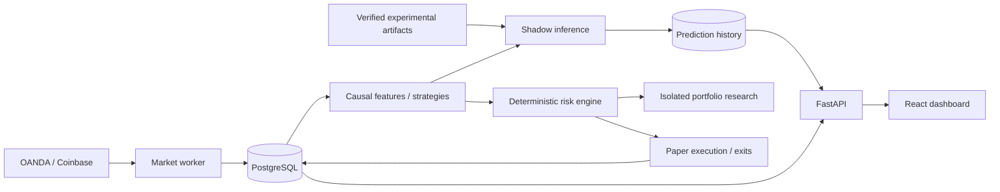

# Architecture

The API exposes read endpoints and an authenticated paper-suspension endpoint. It has no order-submission or live-activation route. LLM outputs cannot reach execution.

Domain schemas validate candles, quotes and candidates. Candles have unique source/instrument/timeframe/time keys. Orders have unique signal IDs. The account lock serializes risk evaluation and reservation: BEGIN IMMEDIATE on SQLite, row locking on PostgreSQL. Schema v1 has a frozen migration snapshot.

The market worker streams quotes and polls completed historical candles. Strategies and features are causal. The paper gateway checks registry scope, calls the pure risk engine, records order transitions and handles quote-based exits. Portfolio replay reuses proposals, risk logic and the conservative exit resolver. It is isolated from database execution and brokers.

Candidate model experiments use shared entry/stop/target proposals, immutable artifacts, explicit costs, input fingerprints and measured validation metrics. Only explicit shadow deployment and replacement are supported; registry SHADOW status never grants execution eligibility. Predictions persist independently from signals/orders. The older directional diagnostic has an incompatible event schema. ACTIVE promotion, drift handling and retraining remain incomplete.

Migrations 0002 and 0003 add shadow observations and persisted paper costs. Fees, financing, source identity and lifecycle state survive process restarts. Legacy open orders lacking execution metadata cause suspension rather than guessed reconstruction.

One API and one worker of each type are appropriate. Do not scale execution workers before account-scoped concurrency tests and leasing are complete. No distributed message broker or Kubernetes is introduced. Initial simplifications include a USD paper account, global correlation bucket, full-close fixed protection and no live transport.
